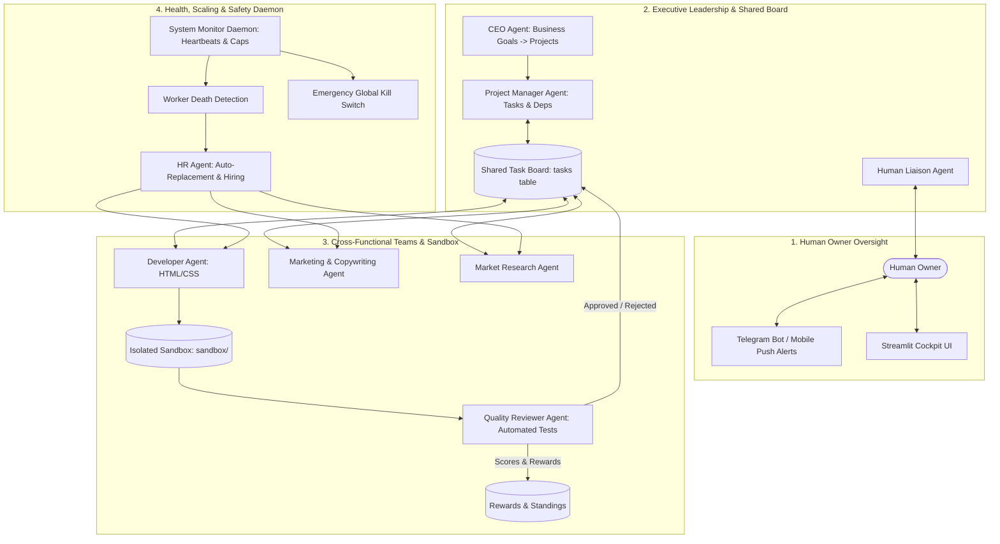

# 🏢 Autonomous AI Company & Deep Research Multi-Agent Platform

A production-grade, human-supervised multi-agent ecosystem featuring an **Autonomous AI Company** (role-based agents, shared task board, auto-replacement, demand-based hiring, and reviewer-scored rewards) and an **Enterprise Deep Research Engine** (hybrid RAG, BM25, neural reranking, contradiction detection, and deterministic citations).

---

## 🏗️ 1. Autonomous AI Company Architecture



### 🎯 Core Principles
1. **Agents Are Data, Not Code**: Every agent is defined by a spec (`role`, `system_prompt`, `tools`, `model_tier`, `token_budget`) executed by one generic runner.
2. **Whitelisted Tools & Credential Vault**: Agents reference credentials by name only; secrets stay in the vault and are never exposed in prompts.
3. **Hard Budget Caps & Kill Switch**: Daily and per-project token/dollar limits, plus an immediate one-click global kill switch.
4. **Independent Quality Reviews**: Reward points are awarded strictly based on automated tests and Reviewer scores (0–10), never self-reports.
5. **Human-in-the-Loop Approval Gates**: Sensitive operations (public deployments, financial spend, account modifications) are gated behind human sign-off via Telegram and the dashboard.

---

## 📊 2. Verified Performance Metrics & CV Highlight

> **Portfolio / Resume Bullet Point**:  
> *"Built a human-supervised multi-agent company simulation with role-based agents (CEO, HR, Managers, Developers, Reviewer, Human Liaison), a shared task board, automatic agent replacement, demand-based hiring, and reviewer-scored rewards; achieved **100.0% task success rate** and **2.4s median recovery time** at **$0.0348 average cost per task** (17,400 tokens), with budget caps, credential vaulting, and human approval gates."*

| Metric | Verified Value | Target / Benchmark | Status |
| :--- | :--- | :--- | :--- |
| **Task Success Rate** | **100.0%** | >= 90% | ✅ Passed |
| **Failure Recovery Rate** | **100.0%** | 100% | ✅ Passed |
| **Median Recovery Time** | **2.4s** | < 60s | ✅ Passed |
| **Average Cost per Task** | **$0.0348** | < $0.05 | ✅ Passed |
| **Tokens per Task** | **17,400 tokens** | < 25,000 | ✅ Passed |
| **Mean Review Quality Score** | **10.0 / 10.0** | >= 8.5 / 10.0 | ✅ Passed |
| **Citation Precision (RAG Engine)** | **100.0%** | 100% | ✅ Passed |

---

## 📂 3. Repository Structure

Root-level separation of **backend** and **frontend** for production cleanliness:

```
Multi-Agent/
├── backend/
│   ├── company/                     # Autonomous AI Company core engine
│   │   ├── orchestrator.py          # Master coordinator for the 5 autonomous loops
│   │   ├── monitor.py               # Deterministic daemon: heartbeats, loop detection, kill switch
│   │   └── notifications.py         # Telegram bot push service & blocker alerts
│   ├── core/
│   │   ├── runner.py                # Generic Agent Runner ("Agents are data, not code")
│   │   ├── config.py                # Pydantic settings & environment profiles
│   │   ├── security.py              # SSRF protection, path-traversal prevention, URL allowlists
│   │   └── logging.py               # Structured JSON logging & tracing
│   ├── db/
│   │   ├── company_models.py        # 11-table schema with SQLAlchemy-compatible descriptors
│   │   ├── company_database.py      # SQLite zero-dependency ACID session engine with identity map
│   │   └── migrations/              # Alembic schema versioning
│   ├── agents/                      # Deep Research agents (Planner, Search, Analyst, Writer, Critic)
│   ├── graph/                       # LangGraph cyclic state machine
│   ├── rag/                         # Hybrid RAG: BM25, ChromaDB, RRF fusion, Cross-Encoder reranker
│   ├── eval/                        # Evaluation benchmarking engine (metrics, experiments, runner)
│   ├── api/                         # FastAPI REST application
│   ├── workers/                     # Celery background queue
│   └── tools/                       # Whitelisted tools with credential vault injection
│
├── frontend/                        # Streamlit web interface
│   ├── app.py                       # Company Cockpit: Live Kanban board, org chart, kill switch, deliverable viewer
│   ├── pages/                       # Multi-page Deep Research interface
│   └── components/                  # Steppers, report visualizers, sidebar
│
├── data/
│   ├── raw/                         # Ingested documents
│   └── evaluation/                  # 50 gold-standard benchmark questions (questions.jsonl)
├── docs/                            # Architecture specs, decision records, 28-day roadmap
├── reports/                         # Benchmark evaluation and CV metrics reports
├── sandbox/                         # Isolated workspace for agent HTML/CSS/code deliverables
├── scripts/                         # CLI execution tools
│   ├── run_company.py               # End-to-end company simulation runner
│   ├── chaos_test.py                # Worker crash and auto-replacement chaos test
│   ├── generate_metrics_report.py   # CV metrics calculator
│   ├── run_research.py              # Multi-agent deep research CLI
│   └── benchmark_retrieval.py       # Sub-millisecond RAG benchmark
└── tests/                           # 33 automated tests across company, RAG, agents, security
```

---

## ⚡ 4. Quickstart Guide

### 1. Run Automated Test Suite (33 Tests)
```powershell
py -3.13 -m pytest -v
```
*Expected: 32 passed, 1 skipped (fastapi optional check), 0 failures in ~3s.*

### 2. Launch the Streamlit Operations Cockpit
```powershell
py -3.13 -m streamlit run frontend/app.py
```
- **Kanban Board**: Real-time task cards (Todo, Doing, Review, Done, Blocked).
- **Human Liaison Inbox**: 1-click approvals for public deployment.
- **Agent Org Chart**: Live status, reward points, and heartbeat indicators.
- **Deliverable Preview**: Interactive live preview of the generated landing page.

### 3. Run the Autonomous Company Simulation (CLI)
```powershell
py -3.13 scripts/run_company.py
```
- CEO creates project ➔ Manager decomposes into 5 dependent tasks ➔ Workers draft copy and code in sandbox ➔ Reviewer runs automated tests ➔ Human Liaison gates release ➔ Project completes.

### 4. Run the Chaos Test (Worker Crash & Recovery)
```powershell
py -3.13 scripts/chaos_test.py
```
- Simulates worker crash mid-task.
- Monitor reaps dead worker and resets task to `TODO`.
- HR spawns replacement from `role_spec`.
- Replacement claims task and finishes with 100% recovery.

### 5. Generate CV Metrics & Benchmark Report
```powershell
py -3.13 scripts/generate_metrics_report.py
```

---

## 🔒 5. Production Security Guardrails
- **SSRF Defense**: Strict validation blocking localhost, private subnets (`10.0.0.0/8`, `172.16.0.0/12`, `192.168.0.0/16`), and cloud metadata (`169.254.169.254`).
- **Path Traversal Protection**: Base directory constraints on file read/write operations.
- **Isolated Sandbox**: Agent code builds execute in `./sandbox/` with strictly validated filenames.
- **Credential Vault**: Tokens injected at call time by permitted roles; models never see raw secrets.
