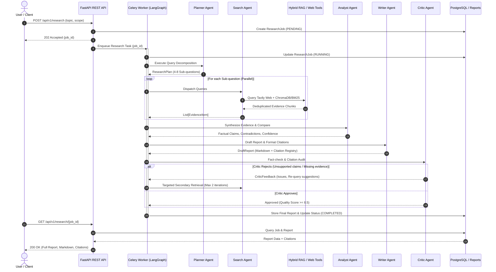

# System Architecture & Technical Specifications
**AI Research & Report Agent — Enterprise Multi-Agent System**

---

## 1. Architectural Philosophy

The AI Research & Report Agent is architected according to four core tenets:
1. **Zero-Trust Information Synthesis**: All external information—whether scraped from the public web or parsed from uploaded corporate files—is treated as untrusted data. Factual statements generated by the system must possess unambiguous provenance linking back to retrieved evidence chunks.
2. **Deterministic Agent Boundaries**: Agents (Planner, Search, Analyst, Writer, Critic) operate under strict Pydantic input/output contracts. No agent modifies arbitrary unstructured strings without typed schema enforcement.
3. **Decoupled Asynchronous Execution**: Multi-agent research workflows frequently execute across several minutes. The API layer (FastAPI) never blocks HTTP worker threads with agent execution; all research tasks are dispatched to Celery background workers coordinated via Redis and persisted in PostgreSQL.
4. **Resilience Through State Persistence**: Long-running multi-agent tasks are fully checkpointed at each state transition using LangGraph's checkpointer mechanism, allowing paused, interrupted, or failed workflows to resume without re-running expensive prior steps.

---

## 2. Multi-Agent Orchestration Flow

---

## 3. Subsystem Breakdown

### 3.1 Retrieval Subsystem (Hybrid RRF + Cross-Encoder)
Retrieval operates in four stages to ensure high recall without sacrificing precision:
1. **Dense Vector Search**: Queries persistent ChromaDB collections utilizing OpenAI embeddings (`text-embedding-3-small`). Retrieves top-30 semantically similar chunks.
2. **Sparse Lexical Search**: Queries a tokenized BM25 index built with `rank-bm25` over document tokens. Captures specific domain terminology, model numbers, IDs, and named entities. Retrieves top-30 lexical chunks.
3. **Reciprocal Rank Fusion (RRF)**: Merges dense and sparse result lists using the standard formula:
   $$\text{RRF\_Score}(d) = \frac{1}{60 + \text{rank}_{\text{dense}}(d)} + \frac{1}{60 + \text{rank}_{\text{sparse}}(d)}$$
4. **Cross-Encoder Neural Reranking**: Evaluates the top-20 merged candidates using `cross-encoder/ms-marco-MiniLM-L-6-v2`. Computes query-passage interaction scores and selects the top-5 to top-10 chunks for the LLM context.

### 3.2 Relational Data Model (PostgreSQL)
Primary application entities and relationships:
- `users`: ID, email, hashed credentials, subscription tier.
- `research_jobs`: Unique job UUID, foreign key to user, research parameters, progress percentage, current agent status, timestamps.
- `documents`: Document ID, user ID, original filename, SHA-256 hash, byte size, total chunk count.
- `document_chunks`: Chunk ID, document ID, chunk index, page number, token length, content hash.
- `evidence`: Global evidence records gathered during research runs, linking to either a document chunk or a verified web URL.
- `research_reports`: Final synthesized reports, markdown text, structured JSON bibliography, critic score, PDF export URL.

---

## 4. Security & Isolation Architecture

1. **Prompt Injection Boundary**: All retrieved web text and ingested documents are treated as data, wrapped inside explicit `<untrusted_content>` tags. System instructions explicitly command agents to ignore directives embedded within retrieved context.
2. **Server-Side Request Forgery (SSRF) Defense**: All outbound HTTP requests made by the web scraping toolkit pass through IP resolution checks that strictly drop connections targeting RFC 1918 private subnets, localhost, and cloud instance metadata services (`169.254.169.254`).
3. **Multi-Tenant Document Isolation**: Every database record and vector collection partition is scoped to `user_id`. Chunks and search queries enforce metadata filtering on `user_id` to prevent cross-tenant data leakage.
