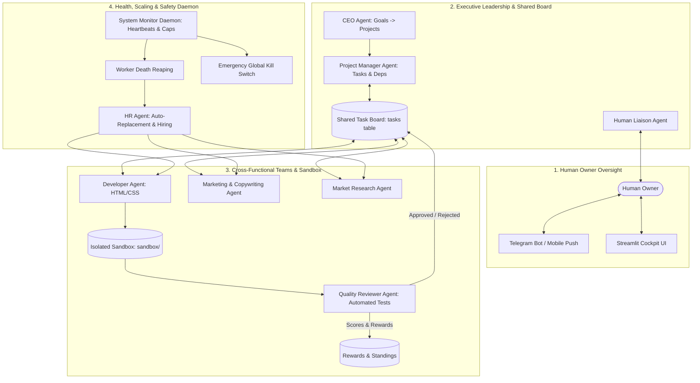
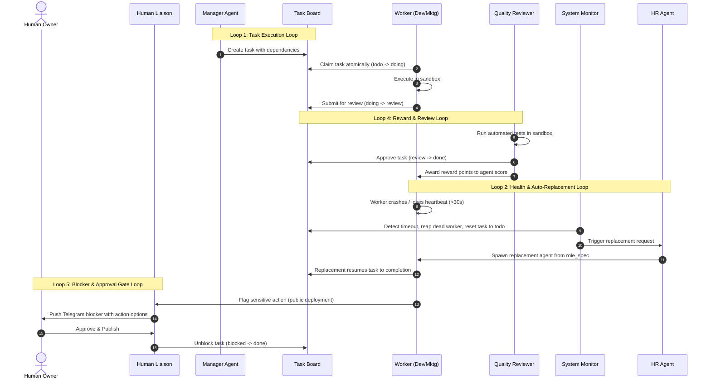

# Autonomous AI Company: Architectural Blueprint

## 1. System Vision & Architecture

The **Autonomous AI Company** is a human-supervised multi-agent enterprise simulation where autonomous agents execute projects from a shared task board, monitor their own health, automatically replace failed workers, scale headcount based on workload, and receive objective reward points.

---

## 2. The 11 Database Tables

| Table | Primary Columns | Purpose |
| :--- | :--- | :--- |
| **`agents`** | `id, role, team_id, status, score, last_heartbeat, replaced_by` | Registry of every agent, its health, reward score, and lineage. |
| **`role_specs`** | `role, system_prompt, tools_json, model_tier, max_steps, token_budget` | Templates cloned by HR to hire new agents. |
| **`teams`** | `id, name, manager_agent_id, min_headcount, max_headcount` | Department boundaries and staffing caps. |
| **`projects`** | `id, name, goal, status, budget_limit, owner_agent_id` | High-level projects created by the CEO. |
| **`tasks`** | `id, project_id, team_id, title, spec, status, owner_agent_id, attempts, depends_on` | Shared board enforcing `todo` ➔ `doing` ➔ `review` ➔ `done`. |
| **`events`** | `id, ts, agent_id, task_id, type, payload_json` | Append-only audit log for tracing and observability. |
| **`budget_ledger`**| `id, ts, agent_id, project_id, tokens, cost, tool_calls` | Financial ledger tracking token usage and cost against caps. |
| **`reviews`** | `id, task_id, reviewer_id, verdict, quality_score, notes` | Independent quality reviews and test results (0.0 to 10.0). |
| **`rewards`** | `id, agent_id, task_id, points, reason, ts` | Point history: bonuses for quality and penalties for rework. |
| **`blockers`** | `id, agent_id, task_id, type, priority, status, details, options` | Escalations requiring human sign-off. |
| **`credentials_registry`**| `name, scope, allowed_roles, vault_ref, last_used` | Secret permissions. Secrets stay vaulted; models never see passwords. |

---

## 3. The 5 Core Autonomous Loops

---

## 4. Security & Credential Vault Architecture
1. **Zero Secret Exposure**: LLM prompts and chat logs never receive raw API keys or passwords.
2. **Credential RBAC**: Tools check `credentials_registry` and inject secrets from the vault at invocation time only if the caller's role is permitted.
3. **Isolated Sandbox Execution**: File operations and code builds are restricted to `./sandbox/` with path traversal protections.
4. **Approval Gates**: Sensitive actions (spending funds, emailing customers, public deployments, credential rotation) require human sign-off via the Liaison.
